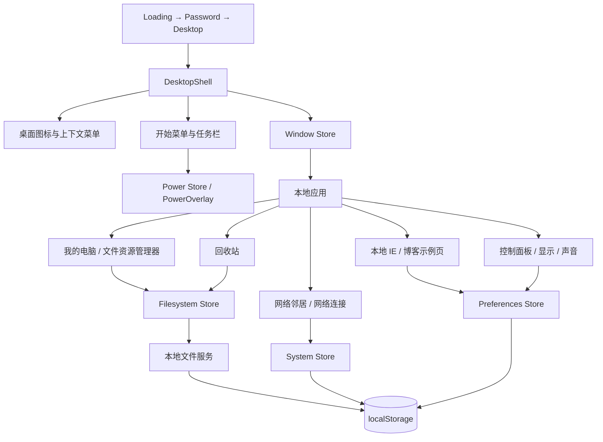
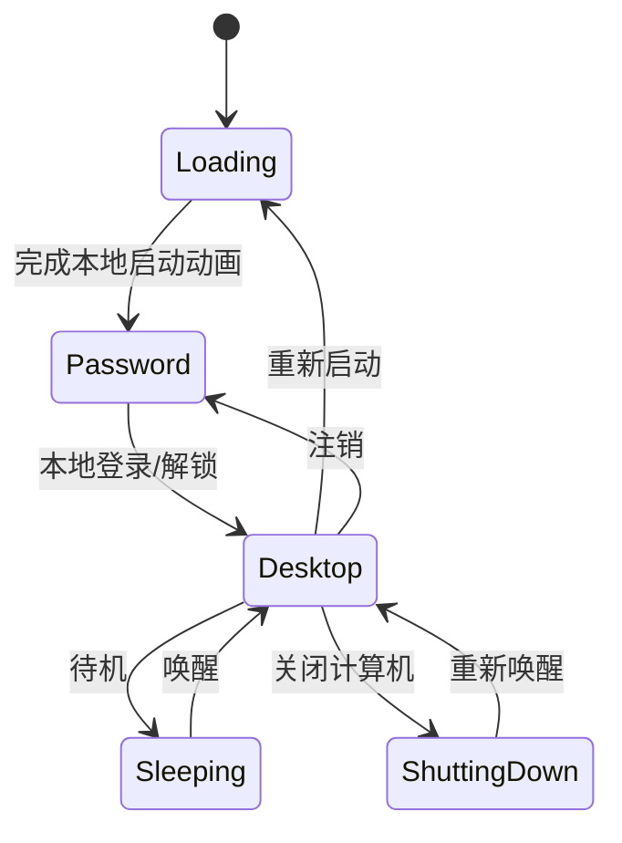

# Windows XP 本地模拟桌面：架构与实现

## 产品范围

在浏览器中模拟 Windows XP 风格的 PC 与移动端桌面。保留现有 Loading、Password 登录入口和本地 XP 素材，提供桌面图标、开始菜单、任务栏、可交互窗口、文件管理、回收站、模拟网络、IE/博客、控制面板和本地电源操作。

文件、设置、收藏夹、网络连接状态和网页内容均为本地 mock。模拟系统不访问真实网站，不使用后端，不发起网络请求。新增能力使用项目现有的 Vue 3、TypeScript、Pinia、Vue Router、CSS 和原生 Audio；没有增加第三方运行依赖。

## 系统结构

Pinia store 放在现有项目约定的 `src/store/`；mock 数据与操作在 `src/mocks/`；manifest 和应用视图在 `src/apps/`、`src/components/apps/`；桌面、窗口、电源层分别位于 `src/components/desktop/`、`src/components/Window/` 和同一桌面目录。

## 模块与状态

- **桌面与窗口**：PC 桌面图标单击选中、双击打开；移动端单击打开。PC 窗口可聚焦、拖动、缩放、最小化、最大化和关闭；移动端将活动应用铺满工作区。任务栏提供窗口切换、时钟和系统托盘。
- **文件系统**：`windows-xp-mock:filesystem` 保存版本化文件树和回收站快照。服务负责创建、重命名、删除、还原、永久删除与同目录重名校验。回收站保留删除前的父目录信息。
- **桌面快捷方式**：`windows-xp-mock:desktop-shortcuts` 保存本地快捷方式名称和隐藏状态。
- **偏好设置**：`windows-xp-mock:preferences` 保存 IE 收藏、最多 12 个标签页及其活动页/导航历史、壁纸、系统音效开关与音量、图标大小和颜色方案；旧 v1 快照读取时会给新增字段补安全默认值。显示和声音更改立即作用于桌面。
- **网络状态**：`windows-xp-mock:system` 只保存本地连接开关；共享计算机和共享文件是预置 mock 数据，不做扫描或连接。
- **电源状态**：`Power Store` 管理当前会话的待机、模拟关机、重启和注销。电源状态不写入本地持久化；刷新会重新进入正常启动流程。
- **IE 与博客**：`src/mocks/browser/pages.ts` 只解析 `about:home`、`windows-xp.local`、`blog.local`、本地文章和本地搜索。标签页、活动标签与前进/后退历史写入偏好设置，重开应用或刷新后恢复。未知地址显示本地错误页。Juejin 主页地址仅以文本展示。
- **声音与外观**：壁纸及登录提示音均来自 `src/assets/`。原生 `<audio>` 捕获浏览器自动播放拒绝；静音与音量只影响本地音频。

localStorage 无效、版本不兼容或字段损坏时，各适配器回退到有效的种子数据/默认偏好。窗口位置、焦点和打开状态只在当前会话内存在。

## 路由和电源流程

PowerOverlay 挂载在应用根部，所以关机对话框、待机遮罩和断电页面可从桌面与登录页调用。关机只显示本地模拟状态，不调用操作系统接口。

## 设计与可访问性

XP 蓝色主题为默认值，提供橄榄绿和银色方案；桌面背景和大小图标在 PC 与手机屏幕间共享设置。控件使用原生按钮、标签和表单输入，移动电源菜单提供触控大小的操作区域。动效使用 CSS/Vue transition，不新增动画库；音频遵循浏览器自动播放限制。

## 验证方式

每个主要模块完成时分别运行 `vue-tsc --noEmit`、`vite build` 和 `git diff --check`，并按模块提交。浏览器预览用于核对文件操作、刷新持久化、各应用入口、电源路径和 PC/移动布局。项目不增加自动化测试框架，也不在未要求时运行测试。

模块验收与实施顺序见 [本地 mock 桌面实施计划](docs/superpowers/plans/2026-10-24-local-mock-xp-desktop.md)。
