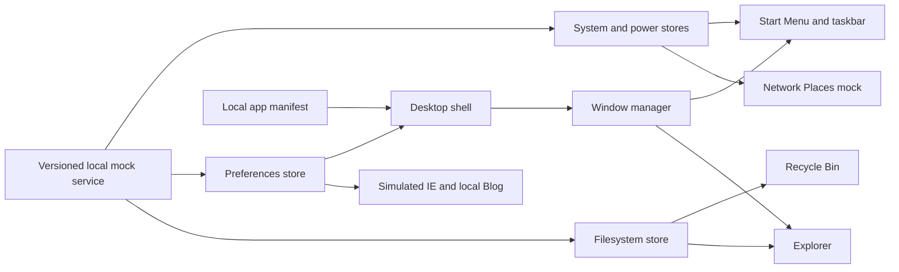

# Local Mock Windows XP Desktop Implementation Plan

> **For agentic workers:** REQUIRED SUB-SKILL: Use superpowers:subagent-driven-development (recommended) or superpowers:executing-plans to implement this plan task-by-task. Steps use checkbox (`- [ ]`) syntax for tracking.

**Goal:** Turn the current Vue desktop shell into a PC and mobile Windows XP style system whose applications and file operations are fully local mock interactions with no real network requests.

**Architecture:** Keep Vue 3, Pinia, Vue Router and CSS transitions. Add a versioned local mock data/service layer backed by `localStorage`, then build focused desktop, window, Explorer, Recycle Bin, Network, simulated IE/blog, Control Panel and power modules on top. PC uses classic windowed interaction; mobile opens applications full-screen with touch-sized controls.

**Tech Stack:** Vue 3 Composition API, TypeScript, Pinia, Vue Router, CSS, browser `localStorage`; no animation, audio, UI, router, or backend dependency additions.

**Spec:** `ARCHITECTURE.md` (local mock scope and module plan below supersede external-link behavior in the current implementation).

## Global Constraints

- All application content, files, folders, history, settings, and network states are local mock data.
- No `fetch`, XHR, WebSocket, remote iframe, external navigation, or `window.open` from any simulated app.
- Seed realistic mock content from the existing XP assets and current owner profile; label invented sample documents/articles as samples.
- Persist filesystem mutations, Recycle Bin contents, and appearance/sound settings in versioned `localStorage`; window positions, focus, and open/closed state reset when the page reloads.
- PC desktop icons select with one click and open with double-click; mobile opens on one tap.
- PC windows support focus/z-order, drag, minimize, maximize/restore, close, and taskbar switching; mobile app windows occupy the available app area above the taskbar.
- Every visible button or menu item performs a local action or is clearly disabled; no dead controls or browser-default context menu inside the desktop.
- Existing loading and login routes remain the system entry flow; preserve their XP visual identity.
- Respect `prefers-reduced-motion`; use CSS and Vue transitions rather than adding an animation package.
- Use native audio and handle autoplay rejection; provide a local mute/volume state.

## Review Focus

- Reload after create, rename, delete, restore, empty, or appearance changes; expected persisted state must be valid and version-safe.
- Empty, large, duplicate-name, and malformed local-storage states; expected safe fallback to seeded/default data without a broken desktop.
- Double-click and touch input; expected one app launch per gesture, no duplicate windows, and no missed touch action.
- Rapid focus/minimize/restore/close and viewport resize; expected correct active window, z-order, taskbar item, and on-screen bounds.
- Unknown or URL-like address input in simulated IE; expected local mock error/search result with zero outbound requests.

## Module Map

- `src/mocks/`: mock data schema, seed data, local persistence adapter, and file-operation service.
- `src/store/`: Pinia state for filesystem, desktop preferences, power state, and windows; stores call mock services rather than embedding file mutation logic. This follows the repository's existing singular directory convention.
- `src/apps/`: application manifest, local route catalog, and app-specific view components.
- `src/components/desktop/`: shell, icons, context menus, Start menu, taskbar, tray and desktop selection state.
- `src/components/window/`: XP title bar, window frame, controls, resize/drag behavior and mobile full-screen frame.
- `src/components/apps/`: Explorer, Recycle Bin, Network Places, simulated IE, local Blog, Control Panel, About/System Information.
- `src/styles/`: XP visual tokens, window/menu states, responsive rules and reduced-motion behavior.
- Keep `src/pages/Loading` and `src/pages/Password` as boot/login flow; route to one shared desktop shell that chooses PC/mobile presentation responsively.

## Task 1: Local mock filesystem and persistence contract

**Files:**
- Create: `src/mocks/filesystem/types.ts`
- Create: `src/mocks/filesystem/seed.ts`
- Create: `src/mocks/filesystem/storage.ts`
- Create: `src/mocks/filesystem/service.ts`
- Create: `src/store/filesystemStore.ts`
- Modify: `src/apps/manifest.ts`

**Interfaces:**
- `MockEntry`: `{ id: string; parentId: string | null; name: string; kind: 'folder' | 'file'; type: string; size: number; modifiedAt: number; content?: string; system?: boolean }`.
- `FilesystemSnapshot`: `{ version: 1; entries: MockEntry[]; recycleBin: MockEntry[] }`.
- `filesystemService`: `load(): FilesystemSnapshot`, `list(parentId: string): MockEntry[]`, `createFolder(parentId: string, name: string): MockEntry`, `createFile(parentId: string, name: string, content: string): MockEntry`, `rename(id: string, name: string): void`, `moveToRecycleBin(id: string): void`, `restore(id: string): void`, `permanentlyDelete(id: string): void`, `emptyRecycleBin(): void`, `read(id: string): MockEntry | undefined`.
- `useFilesystemStore`: reactive snapshot plus actions that call `filesystemService` and refresh store state.
- `localStorage` key: `windows-xp-mock:filesystem`; malformed/unknown versions load the seed and replace invalid persisted data.
- Seed `我的电脑`, `C:` and `D:` mock drives, `我的文档`, `桌面`, `图片收藏`, `音乐`, and clearly marked sample TXT/JPG/MP3 entries.
- Moving a folder to the Recycle Bin moves its full descendant subtree as one restorable unit; restoring returns the subtree to its original parent. Permanent deletion removes the subtree.
- Names are case-insensitively unique within one parent. Reject empty names, path separators, `.` and `..`; never overwrite an existing entry.

- [x] Define the filesystem types and v1 seed tree.
- [x] Implement load/parse/validate/default behavior in the storage adapter.
- [x] Implement local create/list/read/rename/delete/restore/empty operations and same-folder name conflict rules.
- [x] Connect Pinia store actions to the service and expose computed folder contents/counts.
- [x] Run the project's type-check and production build.
- [ ] Inspect persisted values manually in browser devtools during UI integration.

## Task 2: Desktop shell, icons, menus, and taskbar behavior

**Files:**
- Create: `src/components/desktop/DesktopShell.vue`
- Create: `src/components/desktop/DesktopContextMenu.vue`
- Create: `src/components/desktop/StartMenu.vue`
- Create: `src/components/desktop/Taskbar.vue`
- Modify: `src/pages/DeskTop/index.vue`
- Modify: `src/pages/DeskTop/IconGroup/index.vue`
- Modify: `src/global.css`
- Remove: `src/pages/DeskTop/PCDeskTop/index.vue`
- Remove: `src/pages/DeskTop/MobileDeskTop/index.vue`
- Remove: `src/pages/DeskTop/Footer/index.vue`

**Interfaces:**
- Shell consumes `desktopApps`, window store, preference store and power store.
- Desktop context menu emits `open`, `refresh`, `sort`, `new-folder`, `properties`; menus close on outside click, Escape, or action.
- Start Menu launches local app IDs, exposes pinned/recent local apps and power commands.
- Taskbar displays all open app windows, active state, clock, sound/network tray status and Start Menu toggle.
- PC icons retain one-click selection/double-click open; mobile icons open on a single tap.
- Icon context menu provides Open, Rename, Delete, Properties; desktop blank-area menu provides Arrange, Refresh, New Folder, Properties. PC supports marquee selection, arrow-key navigation, F2 rename, Delete to Recycle Bin and Ctrl+A.

- [x] Move PC/mobile route selection under one shell boundary and keep separate presentation components only where interaction differs.
- [x] Implement desktop selection, icon focus, double-click timing and desktop right-click menu.
- [x] Implement functional Start Menu launch/search against local app manifest.
- [x] Implement taskbar window switching/minimize behavior, clock cleanup and local tray indicators.
- [x] Verify all shell controls operate without external navigation and resize between 700px layouts.

## Task 3: Window manager and XP window frame

**Files:**
- Modify: `src/store/windowStore.ts`
- Modify: `src/components/Window/AppWindow.vue`
- Modify: `src/components/desktop/DesktopShell.vue`
- Modify: `src/global.css`

**Interfaces:**
- `WindowInstance`: `{ id: string; appId: string; title: string; icon: string; state: 'normal' | 'minimized' | 'maximized'; zIndex: number; x: number; y: number; width: number; height: number }`.
- `useWindowStore`: `open(appId)`, `focus(id)`, `minimize(id)`, `toggleMaximize(id)`, `close(id)`, `move(id, x, y)`, `resize(id, width, height)`, and getters for active/visible/taskbar windows.
- Default one instance per app except simulated IE, which supports multiple tabs in one app window; prevent duplicate `open()` for singleton apps.
- Mobile maps the active window to the app viewport and keeps taskbar navigation available.

- [x] Implement store transitions and one-instance-per-app policy.
- [x] Implement pointer-based drag and resize, clamped to viewport and taskbar bounds.
- [x] Implement title-bar double-click maximize/restore and XP caption buttons.
- [x] Connect taskbar state to minimize/restore/focus and test rapid window transitions manually.
- [x] Add keyboard behaviors: Escape closes menus/dialogs, Alt+F4 closes active window, and Enter activates focused desktop icon.

## Task 4: Explorer and mock file operations

**Files:**
- Create: `src/components/apps/ExplorerApp.vue`
- Create: `src/components/apps/ExplorerToolbar.vue`
- Create: `src/components/apps/FileItem.vue`
- Modify: `src/apps/manifest.ts`
- Modify: `src/components/Window/AppWindow.vue`

**Interfaces:**
- Explorer state: current folder ID, back/forward history, selected entry IDs, sort key/order, view (`icons` or `details`).
- Explorer operations use `useFilesystemStore`; route breadcrumbs and double-click folder/file open are local only.
- Context actions: Open, New Folder, Rename, Delete, Properties; files open a local preview dialog for supported TXT/image/audio samples.

- [x] Build My Computer drives and folder navigation with XP task pane and address/breadcrumb bar.
- [x] Add icon/details views, sorting, selection, keyboard navigation and local file preview.
- [x] Add create/rename/delete operations with name validation and same-folder conflict feedback.
- [x] Add Explorer context menu and navigation history.
- [x] Create, rename, and delete a temporary folder in an isolated local origin; reload after each operation and confirm the persisted result.

## Task 5: Recycle Bin

**Files:**
- Create: `src/components/apps/RecycleBinApp.vue`
- Create: `src/components/apps/ConfirmDialog.vue`
- Modify: `src/components/apps/ExplorerApp.vue`
- Modify: `src/components/Window/AppWindow.vue`
- Modify: `src/components/desktop/DesktopShell.vue`
- Modify: `src/pages/DeskTop/IconGroup/index.vue`
- Modify: `src/apps/manifest.ts`
- Modify: `src/mocks/filesystem/types.ts`
- Modify: `src/mocks/filesystem/storage.ts`
- Modify: `src/mocks/filesystem/service.ts`

**Interfaces:**
- Recycle Bin consumes the `recycleBin` collection from `useFilesystemStore`.
- Actions: restore selected/all items, permanently delete selected, empty bin with confirmation; all state changes remain local.

- [x] Implement empty and populated XP-style Recycle Bin views.
- [x] Add restore/delete/empty actions and confirmation dialog.
- [x] Feed item counts and empty/populated icon state back into desktop/task pane.
- [x] Verify restored items return to their original parent and persisted state survives reload.

## Task 6: Local Network Places and system tray

**Files:**
- Create: `src/store/systemStore.ts`
- Create: `src/components/apps/NetworkPlacesApp.vue`
- Create: `src/components/apps/NetworkConnectionsApp.vue`
- Modify: `src/components/desktop/Taskbar.vue`
- Modify: `src/apps/manifest.ts`
- Modify: `src/components/Window/AppWindow.vue`
- Modify: `src/components/desktop/DesktopShell.vue`
- Create: `src/store/systemStore.ts`

**Interfaces:**
- Local network state: connected/disconnected, connection name, mock signal, local shared-computer list.
- Connect/disconnect toggles only local state; shares display seeded files marked shared; no discovery or socket request.

- [x] Add seeded local connection and shared-computer mock records.
- [x] Build Network Places/Connections screens with connect/disconnect and status actions.
- [x] Reflect local network state in the tray icon and Network Places list.
- [x] Inspect connection actions and source scan to confirm state changes only use local storage and no network request APIs.

## Task 7: Simulated Internet Explorer and local Blog

**Files:**
- Create: `src/mocks/browser/pages.ts`
- Create: `src/components/apps/InternetExplorerApp.vue`
- Create: `src/components/apps/BlogApp.vue`
- Modify: `src/apps/manifest.ts`
- Modify: `src/store/windowStore.ts`

**Interfaces:**
- `localPages`: local-only routes for `about:home`, `http://windows-xp.local/`, `http://blog.local/`, and mock article paths.
- `resolveLocalPage(address: string)`: normalized local page or a local simulated navigation-error page; never calls browser navigation/network APIs.
- IE state: tabs, active tab, address, back/forward history, favorites stored in preferences; search routes to local mock results.
- Blog uses local profile summary and clearly labeled sample post content. Existing Juejin URL is shown as text only, never as a clickable outbound link.

- [x] Remove `externalUrl` launching and all `window.open` behavior from app manifest/window store (completed in Task 1 under the global offline rule).
- [x] Build local IE chrome (address field, back/forward, refresh, home, favorites, tabs) over local pages.
- [x] Build local blog profile, article list and mock article detail navigation.
- [x] Route unknown addresses to a local error page; confirm there are no remote requests or external browsing contexts.

## Task 8: Control Panel, appearance, and sound

**Files:**
- Modify: `src/store/preferencesStore.ts` (introduced in Task 7 for browser favorites)
- Create: `src/components/apps/ControlPanelApp.vue`
- Create: `src/components/apps/DisplayPropertiesApp.vue`
- Create: `src/components/apps/SoundPropertiesApp.vue`
- Modify: `src/components/desktop/Taskbar.vue`

**Interfaces:**
- Preferences schema v1: wallpaper ID, sound enabled, sound volume (0..1), icon size and theme color.
- Preference service saves validated values in `windows-xp-mock:preferences`.
- System event sounds use existing local MP3 only and respect enabled/volume/autoplay restrictions.

- [ ] Add versioned preferences store and local persistence.
- [ ] Implement Control Panel categories and Display Properties wallpaper selection using existing local assets.
- [ ] Implement sound toggle/volume with local preview sound and tray toggle.
- [ ] Apply preference changes immediately on PC and mobile; verify after reload.

## Task 9: Power actions and boot/login integration

**Files:**
- Create: `src/store/powerStore.ts`
- Modify: `src/components/Modal/ShutDown/ShutDown.vue`
- Modify: `src/components/Modal/ShutDown/index.ts`
- Modify: `src/pages/Password/index.vue`
- Modify: `src/pages/DeskTop/index.vue`

**Interfaces:**
- Power state: `running | shutting-down | sleeping | restarting | logged-off`.
- Restart/log-off return to existing local loading/password routes; sleep shows a local wake overlay; shutdown shows local power-off screen with a wake/restart action.
- No OS shutdown API or external navigation is called.

- [ ] Replace current modal side effects with typed local power actions.
- [ ] Implement XP-style shut down choices: Stand By, Turn Off, Restart, Cancel; mobile uses touch-friendly dialog.
- [ ] Connect taskbar Start Menu power commands and route transitions.
- [ ] Verify cancel, sleep/wake, logoff, restart and shutdown/wake all remain in the app.

## Task 10: Integration and offline review

**Files:**
- Modify affected modules from Tasks 1-9.
- Modify: `ARCHITECTURE.md`

- [ ] Walk the complete boot -> login -> desktop -> Explorer -> file mutation -> Recycle Bin -> restore -> settings -> restart flow on PC and mobile.
- [ ] Run `./node_modules/.bin/vue-tsc --noEmit` and `./node_modules/.bin/vite build`.
- [ ] Search source for `fetch`, `XMLHttpRequest`, `WebSocket`, `window.open`, remote iframe and external navigation; remove any app-path occurrence.
- [ ] Inspect desktop at narrow phone width, tablet width and desktop width; confirm title bars, menus, controls and taskbar remain operable.
- [ ] Confirm persisted filesystem/preferences tolerate invalid storage and version mismatch.

## Approaches Considered

- **Page-local hard-coded mock data:** fastest for one screenshot, but every app would diverge and file actions could not persist coherently.
- **Central mock service plus Pinia stores and versioned `localStorage` (recommended default):** realistic shared file operations and settings with reload persistence, no backend or external requests; adds a small service/schema layer that must be kept consistent.
- **In-memory Pinia-only data:** simplest state flow but all file/settings work disappears on reload, which weakens the desktop simulation.

The user's stated local-only constraint selects the central mock-service approach. Since persistence preference was not returned, this plan defaults to `localStorage`; the choice can be changed before implementation.
